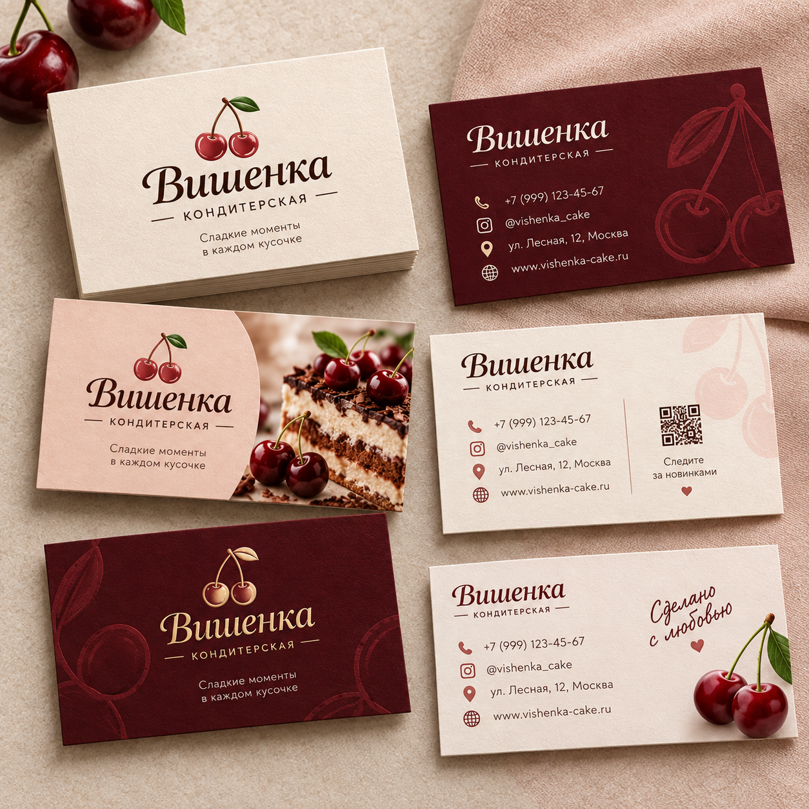
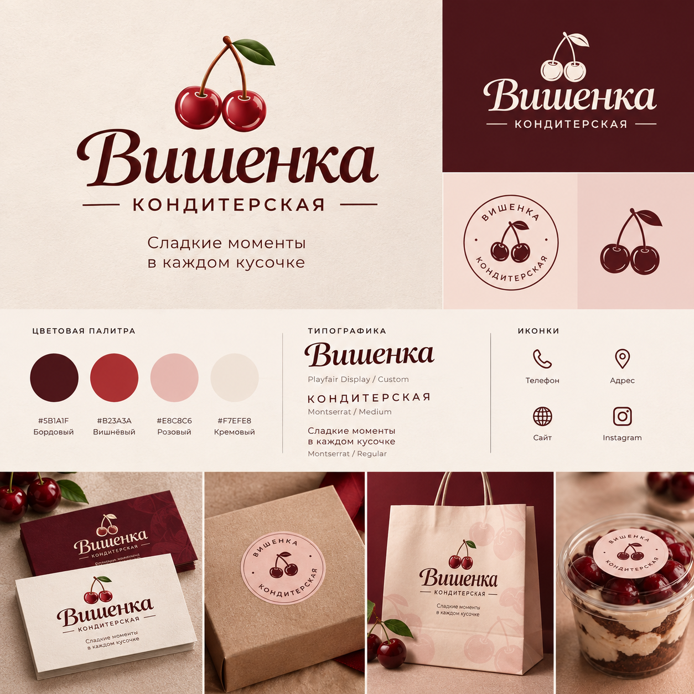
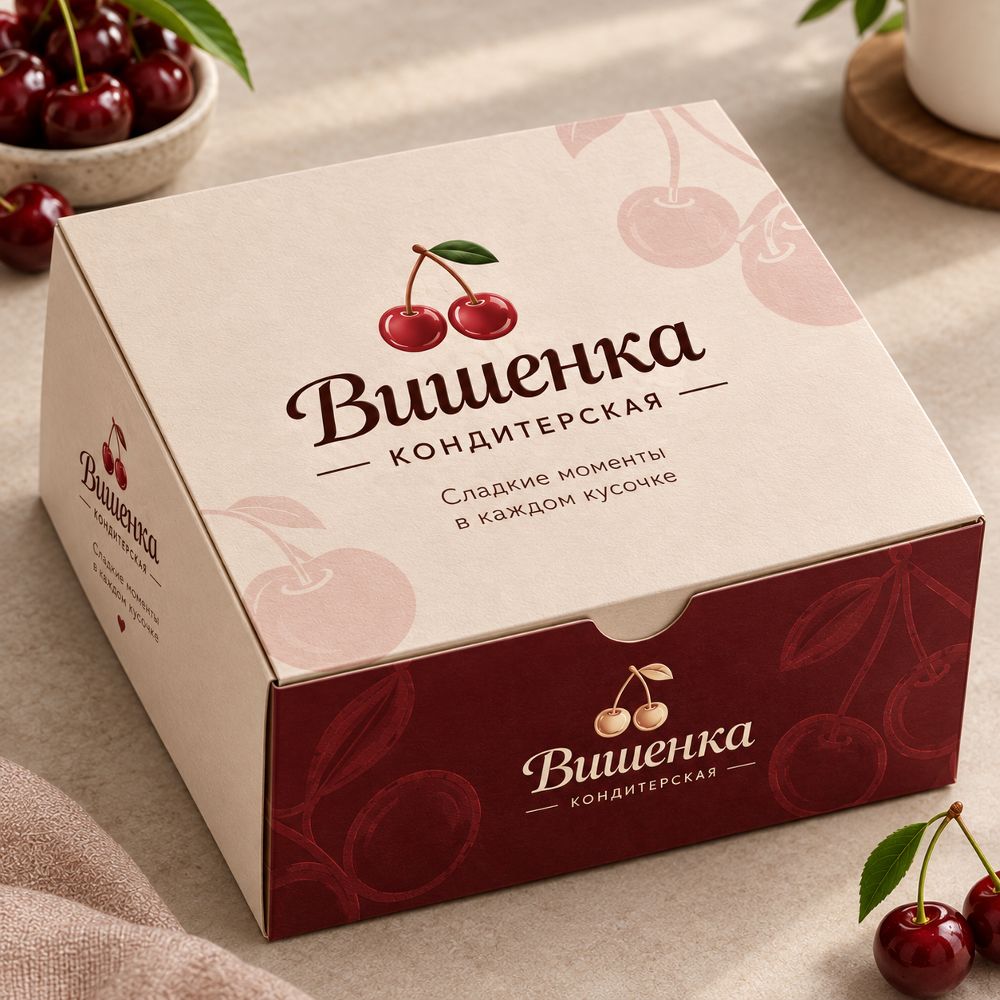

# Vishenka — Pastry Shop Branding

**Portfolio concept · PANTIK / Pavel Kashyn**

A pastry shop identity concept built around a cherry symbol, burgundy tones and soft cream backgrounds. Includes a brand presentation, business card mockups and cake packaging.

## Gallery

## About

Presented as a design concept for portfolio purposes. Brand names, sample contact details and promotional offers shown in the visuals are part of the concepts.

This repository contains image exports. Editable design source files are not included.

[Portfolio](https://pantikdesign.pages.dev/) · [Behance](https://www.behance.net/paveldesigns) · [Contact](https://t.me/pk_designstudio)
